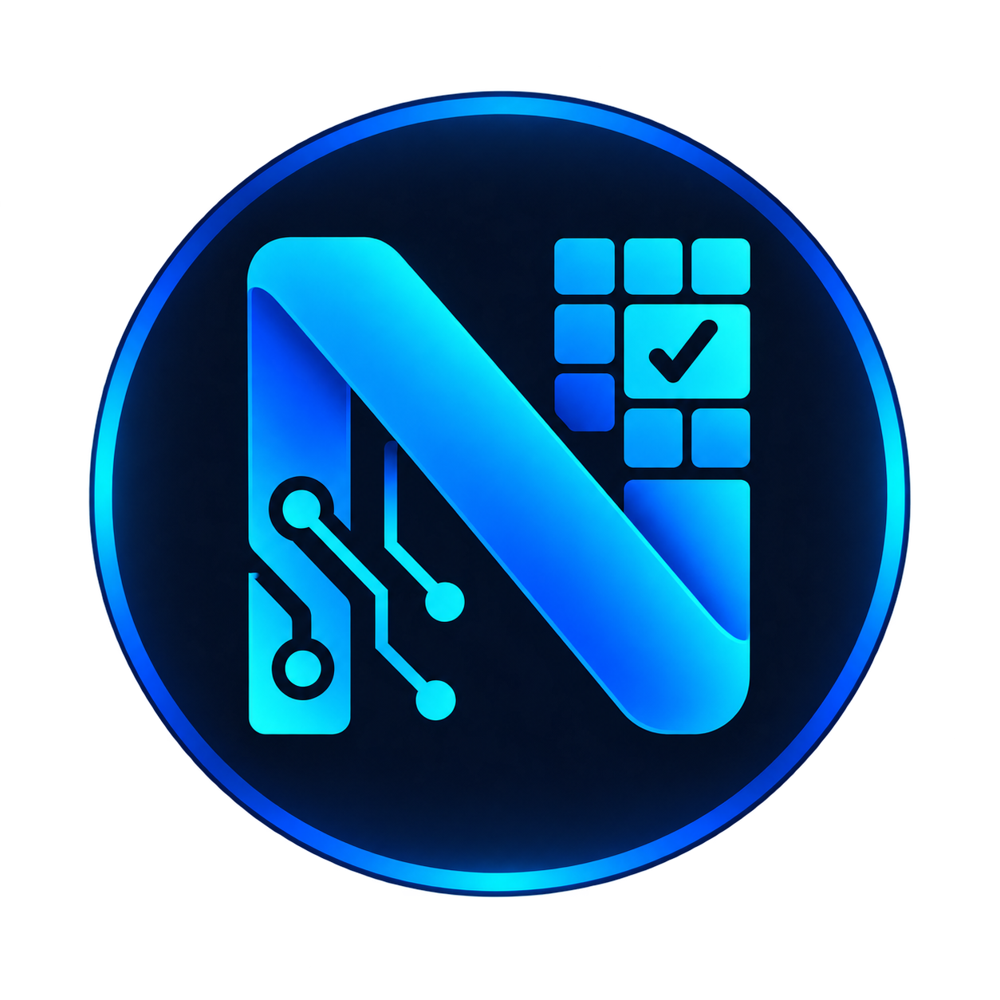

# Numera CHA-Solver

<div align="center">



[](LICENSE) [](Cargo.toml) [](Cargo.toml) [](Cargo.toml) [](docs/DESKTOP.md) [](docs/MODELS.md) [](docs/GPU.md) [](docs/ARCHITECTURE.md) [](docs/ARCHITECTURE.md) [](Cargo.lock) [](docs/QUICKSTART.fa.md) [](docs/QUICKSTART.fa.md) [](#donate)

</div>

**Local perception and accessible human review—not a universal CAPTCHA solver.**

Version 0.4.2 updates the locked native dependencies while preserving the direct MCP lifecycle introduced in0.4.1. MCP runs directly inside the client-owned native process: no separately started server is needed for `args:["bridge"]`. Revision-bound human review, strict device selection and Windows/Linux/Apple Silicon delivery remain unchanged. Release archives carry owner self-signed signatures; verify the [pinned signing identity](docs/SIGNING.md), not only checksums. Self-signed does not mean publicly trusted or notarized. Release assets are published only after exact-revision GitHub-hosted build/runtime/package validation; authored support alone is not execution evidence. [Commit-bound validation](reports/VALIDATION.md). The owner's [custom noncommercial network share-alike license](docs/LICENSING.md) is source-available, not GNU AGPL or OSI-approved open source. Unconditional voluntary donations remain permitted.

Historical Windows 0.2.0 passed final verification on `43c272e`: 43 native tests and all 16 build/device/browser/package/launcher/rollback stages. That evidence does not certify 0.3.0 or other platforms. Models, task state, configuration and operational logs remain separate from disposable build artifacts. [Exact historical evidence](reports/VALIDATION.md).

Available: restricted arithmetic, actual local text-line OCR, typed async SDK, JSON CLI, authenticated loopback API, durable cancellable tasks, model inventory/acquisition/verification and local evidence dashboard. No paid-service hidden fallback, browser stealth, target impersonation or third-party protection bypass.

## Start

Download your platform's verified package from [GitHub Releases](https://github.com/KiaroSama/Numera-CHA-Solver/releases), verify the detached signature with the pinned key ([signing guide](docs/SIGNING.md)), check `SHA256SUMS.txt`, then follow the [native/desktop guide](docs/DESKTOP.md). New releases use the exact successful hosted artifacts; macOS/Linux binaries are not delivered as chat attachments. Builds and tests for this delivery run only on GitHub-hosted CI. Windows PowerShell7 example:

```powershell
./bin/numera-cha.exe --device cpu recognize --text "12 * 3 = ?"
```

Linux/macOS:

```bash
./bin/numera-cha --device cpu recognize --text "12 * 3 = ?"
```

```powershell
./bin/numera-cha.exe models fetch ppocr-v6-small
```

```powershell
./bin/numera-cha.exe recognize --text "12 * 3 = ?"
```

```powershell
./run.ps1
```

Dashboard: `http://127.0.0.1:8765`. Connect with the locally generated credential in `data/api-token.txt`; never publish or attach its value. Stop with `./scripts/stop.ps1`.

CLI/SDK defaults remain CUDA on Windows/Linux and CPU on macOS; the desktop defaults to its bundled CPU runtime unless explicitly configured. Set `NUMERA_DLL_DIRECTORY` to compatible CUDA/cuDNN DLLs when selecting CUDA. Hosted runners provide actual CPU evidence, not GPU evidence. Explicit CPU: `./bin/numera-cha.exe --device cpu recognize --image <licensed-image>`.

## Agent MCP and human review

The client launches the installed native executable with `args:["bridge"]`; from0.4.1 it directly owns the local runtime, without a separately started HTTP server or token. Merge this entry into Claude Desktop's `claude_desktop_config.json`; preserve existing servers:

```json
{
  "mcpServers": {
    "Numera-CHA-Solver-MCP": {
      "command": "/absolute/path/to/numera-cha-solver/bin/numera-cha-solver-mcp",
      "args": ["bridge"],
      "env": {
        "NUMERA_ROOT": "/absolute/path/to/numera-cha-solver",
        "NUMERA_MCP_PORT": "1583",
        "NUMERA_DEVICE": "cpu"
      }
    }
  }
}
```

Replace both placeholder paths with your actual installation. `cpu` matches the distributed CPU runtime; for verified NVIDIA hardware, select `cuda` with matching GPU libraries ([device setup](docs/MCP.md#device-and-runtime)). Direct mode uses this process's device setting; `NUMERA_MCP_PORT` is ignored. To deliberately relay to a separately managed authenticated HTTP instance, use `["bridge","--remote"]` and matching port/root; that explicit mode never falls back. No token belongs in this public snippet. Native tools provide licensed local recognition and pending review/status/cancellation. The person corrects/confirms in the local UI; agents cannot confirm or submit to a site, and `server_verified` stays separate.

[Complete MCP configuration, ports and troubleshooting](docs/MCP.md) · [Portable usage skill](skills/numera-cha-solver/SKILL.md) · [Client packaging](plugins/README.md). Plugin compatibility and native installation are separate; a manifest alone is not proof a client has been exercised.

### Claude Code instruction plugin

Add the repository marketplace:

```bash
claude plugin marketplace add KiaroSama/Numera-CHA-Solver
```

Install its instruction plugin:

```bash
claude plugin install numera-cha-solver@numera-cha-solver-marketplace
```

Invoke `/numera-cha-solver:numera-cha-solver` in a new Claude Code session. This installs instructions only; the MCP connection above remains separate. See the [Claude guide](plugins/claude/README.md) for direct session loading, validation and older-archive limitations.

## SDK

```rust
use numera_cha_solver::{config::Settings, sdk::Numera};
use serde_json::json;

#[tokio::main]
async fn main() {
    let sdk = Numera::new(Settings::from_env().expect("valid local configuration"));
    let result = sdk.recognize_value(json!({"kind": "text", "text": "12 * 3"}), None).await;
    println!("{}", serde_json::to_string(&result).expect("result serialization"));
    sdk.close().await;
}
```

Native interfaces: async `recognize(Input, deadline)`, `recognize_value(JSON, deadline)`, `solve`, `capabilities`, `models`, `doctor` and `close`; synchronous metadata-only `detect(&Input)`. CLI and HTTP share this SDK. `solve` is recognition only, never a browser action or owner acceptance. Explicit subtypes must match the implemented engine (`arithmetic` or `generic_text_line`).

Python import compatibility and its synchronous wrapper are intentionally retired by the owner-approved migration. No thin Python production wrapper is provided. `recognized` never implies `server_verified`.

## CLI and API

Commands: `doctor`, `capabilities`, `models list|verify|fetch`, `detect`, `recognize`, `solve`, `serve`, `benchmark`, `report`. JSON goes to stdout; logs go to stderr and per-run files. Exit 0: success; 2: input/configuration/infrastructure failure; 3: unavailable/abstention; 4: failed recognition. Exit 130 denotes an interrupted non-server command; actual console-signal verification remains separate from ordinary JSON/exit tests.

HTTP: `/health/live`, `/health/ready`, `/v1/capabilities`, `/v1/models`, `/v1/detect`, `/v1/recognize`, `/v1/tasks`, `/v1/tasks/{id}`, `/v1/tasks/{id}/cancel`. Bearer or local same-origin session required for v1; task creation requires `Idempotency-Key`. Strict JSON input accepts local data, not arbitrary paths/URLs/endpoints. Default queue32, taskbudget120seconds, retrieval TTL24hours (not a physical-purge guarantee). `/health/ready` returns a timestamped cached integrity snapshot; `checking` is not model readiness. Recognition overload returns `inference_busy`.

## Evidence and coverage

Real first-party PP-OCRv6small weights read the owned synthetic `NUMERA 123` sample on RTX4070Ti. Runtime profiling recorded187CUDA and2CPUshape/support nodes. This proves local model wiring/device execution only—not real CAPTCHA accuracy, multilingual correctness or live acceptance.

<!-- COVERAGE:START -->
| ID | Family | Declared scope | Evidence / blockers |
| --- | --- | --- | --- |
| C01 | Google reCAPTCHA | 5 subtype decisions | Blocked: model/data/owned lifecycle unavailable |
| C02 | Google reCAPTCHA | 2 subtype decisions | Blocked: model/data/owned lifecycle unavailable |
| C03 | Cloudflare Turnstile | 3 subtype decisions | Blocked: model/data/owned lifecycle unavailable |
| C04 | Cloudflare challenges | 3 subtype decisions | Blocked: model/data/owned lifecycle unavailable |
| C05 | hCaptcha | 6 subtype decisions | Blocked: model/data/owned lifecycle unavailable |
| C06 | Arkose FunCaptcha | 6 subtype decisions | Blocked: model/data/owned lifecycle unavailable |
| C07 | GeeTest | 4 subtype decisions | Blocked: model/data/owned lifecycle unavailable |
| C08 | AWS WAF | 2 subtype decisions | Blocked: model/data/owned lifecycle unavailable |
| C09 | Tencent TCaptcha | 4 subtype decisions | Blocked: model/data/owned lifecycle unavailable |
| C10 | Alibaba CAPTCHA | 3 subtype decisions | Blocked: model/data/owned lifecycle unavailable |
| C11 | NetEase Yidun | 3 subtype decisions | Blocked: model/data/owned lifecycle unavailable |
| C12 | Yandex SmartCaptcha | 2 subtype decisions | Blocked: model/data/owned lifecycle unavailable |
| C13 | MTCaptcha | 2 subtype decisions | Blocked: model/data/owned lifecycle unavailable |
| C14 | Capy | 2 subtype decisions | Blocked: model/data/owned lifecycle unavailable |
| C15 | Lemin Cropped | 1 subtype decisions | Blocked: model/data/owned lifecycle unavailable |
| C16 | KeyCAPTCHA | 2 subtype decisions | Blocked: model/data/owned lifecycle unavailable |
| C17 | Friendly Captcha | 2 subtype decisions | Blocked: model/data/owned lifecycle unavailable |
| C18 | ALTCHA | 1 subtype decisions | Blocked: model/data/owned lifecycle unavailable |
| C19 | Prosopo Procaptcha | 2 subtype decisions | Blocked: model/data/owned lifecycle unavailable |
| C20 | Cutcaptcha | 1 subtype decisions | Blocked: model/data/owned lifecycle unavailable |
| C21 | VK CAPTCHA | 1 subtype decisions | Blocked: model/data/owned lifecycle unavailable |
| C22 | DataDome | 2 subtype decisions | Blocked: model/data/owned lifecycle unavailable |
| C23 | HUMAN PerimeterX | 2 subtype decisions | Blocked: model/data/owned lifecycle unavailable |
| C24 | Generic text | 5 subtype decisions | Limited local building blocks; provider accuracy unverified |
| C25 | Generic audio | 3 subtype decisions | Blocked: model/data/owned lifecycle unavailable |
| C26 | Generic spatial | 9 subtype decisions | Blocked: model/data/owned lifecycle unavailable |
<!-- COVERAGE:END -->

[Validation](reports/VALIDATION.md) · [Blockers](reports/BLOCKERS.md) · [Benchmark limits](reports/BENCHMARKS.md) · [Upstream decisions](reports/UPSTREAM_REVIEW.md)

## Documentation

[Persian quickstart](docs/QUICKSTART.fa.md) · [Architecture](docs/ARCHITECTURE.md) · [Providers](docs/PROVIDERS.md) · [Models](docs/MODELS.md) · [GPU](docs/GPU.md) · [Testing](docs/TESTING.md) · [Security](docs/SECURITY.md)

## Logs

UTF8 diagnostic files live under `logs`, resolved from project root. One per execution: `<script>_YYYY-MM-DD_HH-mm-ss_UTC.log`; UTC entries `[timestamp UTC] [LEVEL] [COMPONENT] Message`. INFO/WARNING/ERROR/DEBUG supported; `--debug` enables verbose operational metadata. Logging initialization falls back safely to stderr. Native logs sanitize quoted/nested fields before writing; runtime errors expose stable messages, not raw sensitive exception payloads. Logs rotate at 2 MB with two backups per run; real operational runs are not deleted automatically. Credentials, authorization, cookies, response tokens, signed URLs and raw inputs are not logged. Attach only sanitized relevant logs, never credentials/raw private assets.

## Development and hosted CI

Native dependencies are pinned by `Cargo.lock`; exact `ort` prerelease is an owner-approved reviewed exception. The three-platform workflow runs on GitHub-hosted runners only by manual dispatch; pushes, pull requests and tags do not start CI. It uses two compiler jobs, one test thread, actual CPU inference, native POSIX identity/cleanup regressions, Windows launcher/persistence coverage, real headless Chrome review tests and inspected native/desktop packages. Build/cache/temp paths remain job-contained; the old project self-hosted runner is removed. [Testing and named limits](docs/TESTING.md). No badge substitutes for exact-revision evidence.

Original code uses the [custom noncommercial network share-alike license](LICENSE). Third-party weights/dependencies retain their own grants; read [licensing boundaries](docs/LICENSING.md) and [third-party notices](THIRD_PARTY_NOTICES.md).

## Donate

If this project helps you, donations are appreciated.

| Currency | Network | Address |
| --- | --- | --- |
| Bitcoin (BTC) | Bitcoin | `bc1qmth5m03pu5hujw5xw5jmywam3jj3sqwqupesdt` |
| USDT, BNB, USDC, etc. | BEP20 | `0x0Bd0BA443a8B9cf15922bf7f0Bb0a4b495fD06Ef` |
| USDT, TRX, USDC, etc. | TRC20 | `TWBA3xFTqgZAeAYMxqo85xWnzvty3DcAhw` |
| Ethereum (ETH) | ERC20 | `0x0Bd0BA443a8B9cf15922bf7f0Bb0a4b495fD06Ef` |
| TON | TON | `UQCN8Umo_OfOWqImZetQsrNStPcmLkMAKajFyiCOhso23NDb` |
| Litecoin (LTC) | LTC | `ltc1qntqnnrunadurnw4cshv3qgspywrueyyeyngwuy` |
| Solana (SOL) | Solana | `7B2wkczUjmkDhETwQuknBL8sUsbuV7nErxc317TmQuwR` |
| Polygon (POL) | Polygon | `0x0Bd0BA443a8B9cf15922bf7f0Bb0a4b495fD06Ef` |
